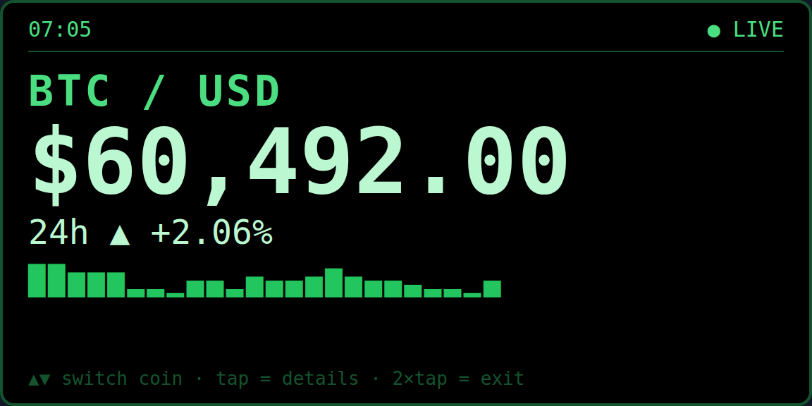
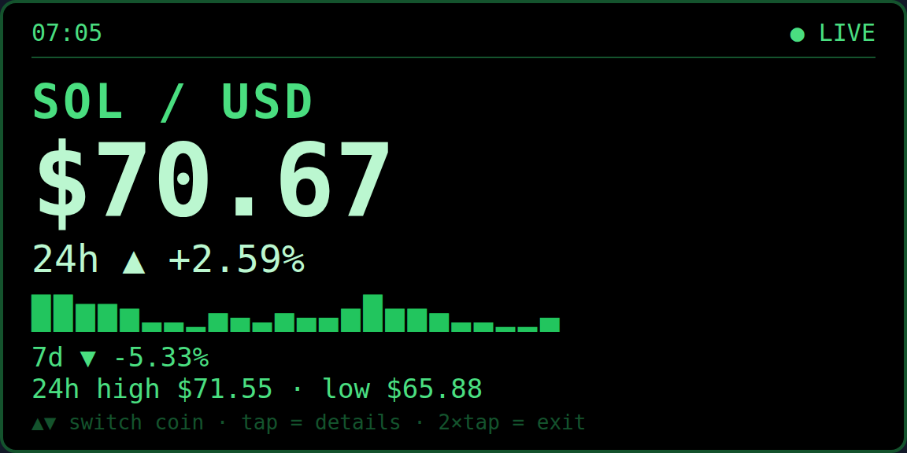
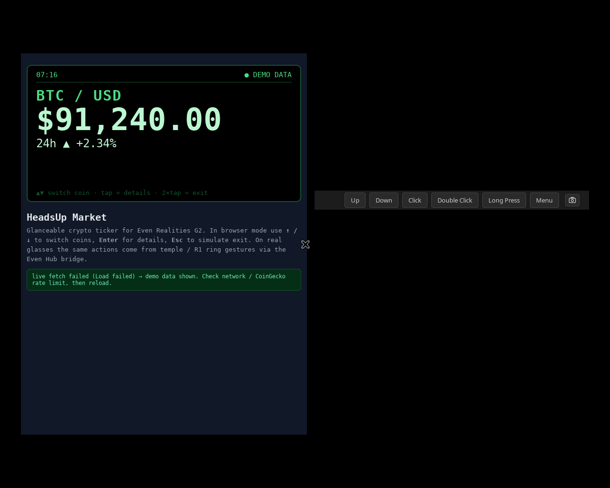

# HeadsUp Market — Glanceable Crypto Ticker for Even G2

**Track:** Crypto & DeFi · Even Realities "Heads Up" Hackathon (DoraHacks)

HeadsUp Market puts the three numbers a crypto holder actually checks —
BTC, ETH and SOL price plus 24h change — on the Even G2 glasses as a
single glanceable screen. No phone unlock, no app hunting: raise your
head, read one huge number, move on.




*Screenshots: BTC live screen and SOL detail view (browser preview of the
576×288 glasses canvas, real CoinGecko data).*



*The same build running in the official Even Hub simulator
(`evenhub-simulator`, v0.9.5). In this sandboxed VM the simulator's WebView
cannot reach the price API, so it shows the honestly labelled `DEMO DATA`
fallback — the same screen a real user sees offline.*

## Demo video

[▶ Watch the 2:20 demo (mp4, 2 MB)](video/headsup-market-demo.mp4) — also
embedded below in the DoraHacks submission. The video walks through the
live BTC screen, swipe-switching to ETH/SOL, tap-for-details, and the
labelled `DEMO DATA` fallback when the price feed is unreachable.

## Why glasses, why this design

The G2 display is 576×288 px, 4-bit greyscale green, rendered by the
firmware from containers — not a phone screen. HeadsUp Market is designed
*for* those constraints instead of despite them:

- **One coin per screen.** Symbol, price (64 px), 24h change, and a
  unicode-block 7-day sparkline. Nothing else competes for attention.
- **Two gestures total.** Swipe up/down (temple or R1 ring) switches the
  coin; a tap reveals detail (7d change, 24h high/low); double-tap exits,
  following the platform's root-page exit contract.
- **Honest data state.** The status bar always says `LIVE` or
  `DEMO DATA` — if the price feed is unreachable, the app shows labelled
  fallback data instead of silently pretending.

## Features

- Live BTC / ETH / SOL prices in USD (CoinGecko free public API, no key)
- 24h change with ▲/▼ direction glyphs (verified to render on G2)
- 7-day sparkline rendered as unicode blocks — no image transfer over BLE
- Detail view: 7d change, 24h high / low
- Auto-refresh every 60 s; clock in the status bar
- Zero-dependency static web app — runs anywhere, including the Even Hub
  simulator's WebView and a plain desktop browser (keyboard/mouse emulate
  the glasses' gestures)

## Run it

Browser preview (no hardware needed):

```bash
cd app
python3 -m http.server 8000
# open http://localhost:8000
# ↑ / ↓ switch coin · Enter toggles detail · Esc simulates exit · click = tap
```

Even Hub simulator / real G2:

```bash
npm install -g @evenrealities/evenhub-cli @evenrealities/evenhub-simulator
# See "Production build" below, then load the app URL / package in the simulator.
```

## How it works

```
CoinGecko API ──HTTPS──▶ Web app (this repo, hosted anywhere)
                              │  EvenAppBridge (injected by Even App)
                              ▼
                        Phone WebView ──BLE──▶ G2 glasses
                        (text container, 576×288, firmware-rendered)
```

- `app/index.html` / `styles.css` — the 576×288 canvas, styled to the
  panel's green monochrome palette (black = pixel off).
- `app/app.js` — market data, rendering, gesture handling.
- `app/even-bridge.js` — a small adapter over the Even Hub bridge: when a
  bridge is present it drives one full-screen text container via
  `createStartUpPageContainer` / `textContainerUpgrade` and routes
  `onEvenHubEvent` gestures; in a plain browser it falls back to the DOM
  canvas so the app is fully demoable without hardware.
- `app/app.json` — Even Hub manifest generated by `evenhub init`
  (official CLI 0.2.0), package `com.zhengjiaming01622.headsupmarket`.

## Production build (before final submission)

The hackathon prototype ships dependency-free for easy review. For the
store-grade build, swap the adapter for the official SDK bundle:

```bash
npm create vite@latest headsup-market -- --template vanilla-ts
npm install @evenrealities/even_hub_sdk@latest
evenhub init   # authoritative app.json
```

The app's logic (`app.js`) ports 1:1: `waitForEvenAppBridge()` replaces
bridge detection, and the same container/event calls are used.

## Data & privacy

Prices come from CoinGecko's free public API. The app collects nothing,
has no accounts, and stores no user data.

## License

MIT
